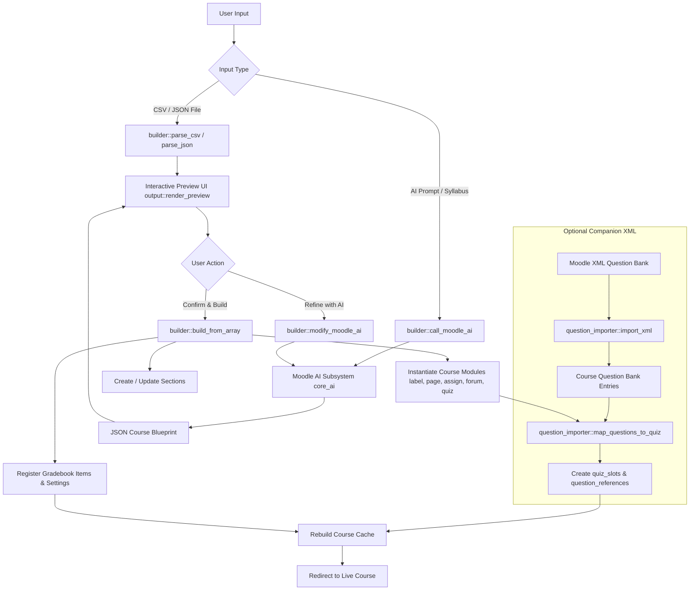

# Moodle Course Builder (`local_coursebuilder`)

[](https://moodle.org)
[](https://php.net)
[-green.svg)](https://docs.moodle.org/dev/Local_plugins)
[](https://www.gnu.org/licenses/gpl-3.0.html)
[](https://moodle.org)

An enterprise-grade Moodle local plugin that automates the rapid generation, structuring, and population of comprehensive Moodle courses. Transform raw curriculum documents, syllabi, structured CSV/JSON files, or natural-language AI prompts into fully realized Moodle courses with sections, lessons, discussion forums, graded assignments, auto-graded quizzes, and automated Question Bank mapping in seconds.

---

## Table of Contents

- [Overview](#overview)
- [Key Features](#key-features)
- [Architecture & Execution Flow](#architecture--execution-flow)
- [Directory Structure](#directory-structure)
- [Input Formats & Specifications](#input-formats--specifications)
  - [1. Course Structure CSV Specification](#1-course-structure-csv-specification)
  - [2. Moodle XML Question Bank Specification](#2-moodle-xml-question-bank-specification)
  - [3. JSON Course Structure Specification](#3-json-course-structure-specification)
- [Heuristic Question-to-Quiz Mapping Algorithm](#heuristic-question-to-quiz-mapping-algorithm)
- [AI Companion & CourseMaker Tooling (`coursemaker/`)](#ai-companion--coursemaker-tooling-coursemaker)
  - [The 3-Step Chunked Workflow](#the-3-step-chunked-workflow)
  - [Unit JSON Schema](#unit-json-schema)
  - [CLI Assembly Script (`assemble_course.py`)](#cli-assembly-script-assemble_coursepy)
- [Installation & Setup](#installation--setup)
  - [Prerequisites](#prerequisites)
  - [Standard Installation](#standard-installation)
  - [Moodle AI Subsystem Configuration](#moodle-ai-subsystem-configuration)
- [Step-by-Step User Guides](#step-by-step-user-guides)
  - [Workflow A: Direct CSV + XML Ingestion](#workflow-a-direct-csv--xml-ingestion)
  - [Workflow B: Natural Language AI Generation](#workflow-b-natural-language-ai-generation)
  - [Workflow C: Interactive Refinement & Revision](#workflow-c-interactive-refinement--revision)
- [Completion Tracking & Visibility Conventions](#completion-tracking--visibility-conventions)
- [Troubleshooting & Best Practices](#troubleshooting--best-practices)
- [Developer Notes & Standards](#developer-notes--standards)
- [License & Copyright](#license--copyright)

---

## Overview

In traditional Moodle administration, creating a robust, multi-unit course is a labor-intensive process requiring educators to manually configure sections, draft HTML lesson pages, set up assignment rubrics, instantiate discussion forums, create quiz activities, and link question bank items one by one.

**Course Builder (`local_coursebuilder`)** bridges this gap by providing an end-to-end automation engine that operates directly within Moodle:

1. **Ingests Structured Data or Generates via AI**: Accepts structured CSV/JSON curriculum blueprints, extracts content from uploaded syllabus documents, or accepts free-form natural language prompts via Moodle's native AI subsystem (`\core_ai\manager`).
2. **Interactive Visual Preview**: Renders an interactive, styled preview of all sections and modular activities before database execution.
3. **Conversational Refinement ("Refine with AI")**: Allows instructional designers to iteratively modify the generated structure (e.g., *"Add a lab assignment to Unit 2"*, *"Rename Section 1 to Orientation"*) using conversational prompts.
4. **Automated Moodle Module Instantiation**: Direct, low-overhead creation of native Moodle course modules (`label`, `page`, `quiz`, `assign`, `forum`, `resource`) with full Gradebook integration, review options, and activity completion settings.
5. **Intelligent XML Question Mapping**: Imports companion Moodle XML question banks into the course-level question bank and employs a scoring algorithm to automatically populate quizzes with matching questions.

---

## Key Features

- **Multi-Source Input Support**:
  - **CSV File Upload**: High-performance batch generation using strict tabular columns.
  - **JSON File Upload**: Hierarchical structure support for automated generation pipelines.
  - **Moodle AI Text Prompt**: Create comprehensive course architectures from a simple instruction prompt.
  - **Syllabus Document Ingestion**: Upload plain text (`.txt`) or Markdown (`.md`) syllabus files; the AI parses learning objectives and maps them into progressive units.
- **Granular Activity Generation**:
  - **Sections**: Topics/weeks created with custom titles and HTML overview summaries.
  - **Labels (`mod_label`)**: Visual HTML unit banners, pacing guides, and section callouts.
  - **Pages (`mod_page`)**: Rich lesson pages with objectives, differentiated notes, and full HTML formatting.
  - **Assignments (`mod_assign`)**: Formatted instructions, student briefs, grading rubrics, and gradebook items.
  - **Forums (`mod_forum`)**: Engaging discussion prompts and teacher facilitation instructions.
  - **Quizzes (`mod_quiz`)**: Pre-configured quiz instances with review options, attempt handling, and grade scales.
- **Automatic XML Question Bank Import & Mapping**:
  - Upload a companion Moodle XML questions file alongside your course structure.
  - Parses questions directly into the course question bank hierarchy.
  - Uses a heuristic keyword/unit/section matching algorithm to link questions into quiz slots without manual intervention.
- **Interactive Review & Modification UI**:
  - Accordion-style preview displaying activity icons, titles, and section breakdowns.
  - Integrated "Refine with AI" form to adjust course elements before running the build.
- **Native Moodle Integration**:
  - Leverages Moodle Core Course APIs (`course_create_sections_if_missing`, `course_add_cm_to_section`, `rebuild_course_cache`).
  - Compatible with Moodle 4.0 through Moodle 4.5+ and Moodle 5.x.
  - Uses Moodle 4.5+ Dependency Injection (`\core\di::get(\core_ai\manager::class)`) for AI generation actions.

---

## Architecture & Execution Flow



---

## Directory Structure

```text
local/coursebuilder/
├── classes/
│   ├── form/
│   │   └── upload_form.php         # Moodle Formslib definition (filepickers, course selector, AI prompt)
│   ├── builder.php                 # Core business logic: CSV/JSON parsing, core_ai caller, module builder
│   ├── output.php                  # Interactive preview renderer with FontAwesome activity icons
│   └── question_importer.php       # Moodle XML importer & heuristic quiz-slot mapping engine
├── coursemaker/                    # External AI companion toolkit for Claude / LLMs
│   ├── CLAUDE_SKILL_PROMPT.md      # Direct Claude skill prompt instructions
│   ├── README.md                   # Documentation for the 3-step chunked generation workflow
│   ├── samples/                    # Ready-to-use sample courses (CSV + XML)
│   │   ├── Physics_Course.csv
│   │   └── Physics_CourseQuestions.xml
│   ├── schemas/
│   │   └── unit_schema.json        # JSON Schema definition for unit JSON files
│   └── scripts/
│       └── assemble_course.py      # Python CLI script compiling unit-*.json into CSV + XML
├── courses/                        # Comprehensive sample datasets & reference generators
│   ├── generate_course.py          # Reference Python script demonstrating programmatic generation
│   ├── Python_Course.csv           # Full 6-unit Python course CSV
│   ├── Python_CourseQuestions.xml  # Companion auto-graded Question Bank XML (30+ questions)
│   └── python_units/               # Modular unit-0.json and unit-1.json examples
├── lang/
│   └── en/
│       └── local_coursebuilder.php # English localization strings
├── final_plan.md                   # Plugin architectural specification & design notes
├── index.php                       # Main UI controller, dispatcher & preview view
├── moodle-course-builder.skill     # Packaged AI agent skill archive
├── settings.php                    # Site administration settings entrypoint
├── SKILL.md                        # Primary AI Agent Skill documentation and prompt reference
├── test_course.csv                 # Minimal test CSV sample
├── test.json                       # Minimal test JSON sample
└── version.php                     # Moodle plugin metadata, version, and dependencies
```

---

## Input Formats & Specifications

### 1. Course Structure CSV Specification

The CSV input must adhere to the exact header layout shown below.

#### Header Row (Mandatory)
```csv
type,section,name,intro,grade,visible,completion,completionview,timeopen,timeclose
```

#### Field Definitions

| Column | Type | Required | Description |
|---|---|---|---|
| `type` | String | **Yes** | Activity or structure type: `section`, `label`, `page`, `quiz`, `assign`, `forum`, `resource` (or `file`). |
| `section` | String / Int | **Yes** for sections | Parent section identifier. Accepts numeric section index (`1`, `2`) or string title (`Unit 1`). Activities inherit the preceding section if left blank. |
| `name` | String | **Yes** | Display title rendered in the course page navigation. |
| `intro` | HTML String | **Yes** | Rich HTML content. For `page`: lesson body. For `label`: inline banner. For `assign`: instructions + rubric. For `quiz`: overview. For `forum`: discussion prompt. |
| `grade` | Float / Int | Optional | Maximum grade points for gradable activities (`assign` defaults to `100`, `quiz` defaults to `10` or `50`). |
| `visible` | Integer (0/1) | Optional | Visibility state: `1` = visible to students, `0` = hidden (teacher review mode). Default: `1`. |
| `completion` | Integer (0-2) | Optional | Completion tracking: `0` = none, `1` = manual by student, `2` = automatic upon conditions. |
| `completionview` | Integer (0/1) | Optional | Automatic completion rule: `1` = student must view the activity to complete it. |
| `timeopen` | Integer | Optional | Unix timestamp for opening quizzes or assignments. |
| `timeclose` | Integer | Optional | Unix timestamp for due/closing dates. |

#### Critical CSV Formatting Rules
1. **Semicolons for Inline Styles**: Never use commas inside HTML inline styles (`style="color: #0284c7; font-size: 14px;"` ✅). Commas will break CSV cell boundaries.
2. **Double Quote Wrapping**: Always encapsulate cells containing HTML, commas, or quotes inside double quotes (`"<div>...</div>"`).
3. **Single Line Per Row**: Do not include raw literal newlines within HTML cells. All content for a single activity row must exist on one continuous line.
4. **Character Encoding**: Save files strictly in **UTF-8** (with or without BOM; the plugin automatically handles UTF-8 BOM headers).

---

### 2. Moodle XML Question Bank Specification

Quizzes generated by `local_coursebuilder` are automatically populated using a companion **Moodle XML Question Bank** file.

#### File Structure
```xml
<?xml version="1.0" encoding="UTF-8"?>
<quiz>
  <!-- Category Declaration (Used by question_importer for quiz auto-mapping) -->
  <question type="category">
    <category>
      <text>$course$/top/[Course Name] / [Section or Subject] / [Category Name]</text>
    </category>
  </question>

  <!-- Multiple Choice Question Instance -->
  <question type="multichoice">
    <name><text>[TAG] Question Preview Stem...</text></name>
    <questiontext format="html">
      <text><![CDATA[<p>What is the primary function of an operating system kernel?</p>]]></text>
    </questiontext>
    <generalfeedback format="html"><text></text></generalfeedback>
    <defaultgrade>1</defaultgrade>
    <penalty>0.3333333</penalty>
    <hidden>0</hidden>
    <single>true</single>
    <shuffleanswers>true</shuffleanswers>
    <answernumbering>abc</answernumbering>
    <correctfeedback format="html"><text>Correct!</text></correctfeedback>
    <incorrectfeedback format="html"><text>Incorrect. Please review the module notes.</text></incorrectfeedback>
    
    <!-- Exactly 1 Correct Answer (fraction="100") -->
    <answer fraction="100" format="html">
      <text><![CDATA[<p>Managing hardware resources and mediating system calls</p>]]></text>
      <feedback format="html"><text>Correct!</text></feedback>
    </answer>
    
    <!-- Exactly 3 Distractors (fraction="0") -->
    <answer fraction="0" format="html">
      <text><![CDATA[<p>Compiling high-level programming code into bytecode</p>]]></text>
    </answer>
    <answer fraction="0" format="html">
      <text><![CDATA[<p>Rendering graphics in the user window manager</p>]]></text>
    </answer>
    <answer fraction="0" format="html">
      <text><![CDATA[<p>Formatting network packets for HTTP transport</p>]]></text>
    </answer>
  </question>
</quiz>
```

#### XML Guidelines
- **Category Hierarchy**: Must start with `$course$/top/`. Separate category levels using space-slash-space (` / `).
- **CDATA Blocks**: Always wrap question text and answer choices in `<![CDATA[ ... ]]>` to prevent XML parsing syntax errors with HTML characters.
- **Answer Fractions**: Assign `fraction="100"` to the single correct option and `fraction="0"` to the three distractors.

---

### 3. JSON Course Structure Specification

The plugin natively accepts JSON files formatted as an array of section and activity objects:

```json
[
  {
    "type": "section",
    "name": "Unit 1: Fundamentals of Computing",
    "intro": "<p>Introduction to computer hardware, memory architectures, and binary logic.</p>"
  },
  {
    "type": "label",
    "name": "Unit 1 Overview Banner",
    "intro": "<div class='alert alert-info'><h3>Welcome to Unit 1</h3><p>Complete lessons 1-3 before attempting the quiz.</p></div>",
    "visible": 1
  },
  {
    "type": "page",
    "name": "Lesson 1 — Architecture Overview",
    "intro": "<div><h3>Learning Objectives</h3><ul><li>Understand CPU execution cycles</li></ul><p>Content goes here...</p></div>",
    "visible": 0,
    "completion": 2,
    "completionview": 1
  },
  {
    "type": "quiz",
    "name": "Unit 1 Quiz — Fundamentals of Computing",
    "intro": "<div><p>Auto-graded quiz testing fundamental computing knowledge.</p></div>",
    "grade": 50,
    "visible": 0,
    "completion": 2,
    "completionview": 1
  },
  {
    "type": "assign",
    "name": "Unit 1 Assignment — Memory Mapping",
    "intro": "<div><p>Complete the memory layout schematic attached below.</p></div>",
    "grade": 100,
    "visible": 0,
    "completion": 1
  },
  {
    "type": "forum",
    "name": "Unit 1 Discussion — Moore's Law",
    "intro": "<div><blockquote>Is Moore's Law still relevant in modern semiconductor manufacturing?</blockquote></div>",
    "visible": 0,
    "completion": 1
  }
]
```

---

## Heuristic Question-to-Quiz Mapping Algorithm

When a companion Moodle XML questions file is uploaded, `question_importer.php` automatically links questions into the newly created quizzes without requiring manual slot assignment in Moodle's quiz editing interface.

The matcher evaluates each quiz against every XML category path in the question bank using the following scoring heuristics:

| Match Criterion | Weight / Points | Evaluation Logic |
|---|---|---|
| **Section Name Match** | `+10` points | Case-insensitive check if the course section name appears in the XML category path. |
| **Unit Number Match** | `+20` points | Regex extraction of unit number (e.g. `Unit 2` in quiz name vs `Unit 2` in category path). |
| **Topic Keyword Overlap** | `+5` points per word | Tokenizes quiz title (excluding generic terms like `unit`, `quiz`, `test`, `exam`), checks overlap with words $> 3$ characters. |
| **Minimum Confidence Threshold** | **`15` points** | A match is only confirmed if the total heuristic score is $\ge 15$. |

### Auto-Mapping Example
- **CSV Quiz Activity**: `Unit 1 Quiz — Python Basics` inside Section `Unit 1`
- **XML Category Path**: `$course$/top/Python Programming / Unit 1 / Unit 1 - Python Basics`
- **Scoring**:
  - Section name match (`Unit 1` in path): `+10`
  - Unit number match (`Unit 1` in path): `+20`
  - Keyword match (`python`, `basics`): `+10`
  - **Total Score = 40** (Firm match ✅). The importer binds all questions in that category to the quiz's `quiz_slots` and `question_references`.

---

## AI Companion & CourseMaker Tooling (`coursemaker/`)

The repository includes a dedicated AI generation suite in the `coursemaker/` folder. This toolset enables external LLMs (Claude, GPT, Gemini) or CLI scripts to transform lengthy source materials (PDF textbooks, Word syllabi, slide decks) into paired CSV + XML bundles.

### The 3-Step Chunked Workflow

Large documents often overwhelm AI context limits when attempting to generate entire courses at once. `coursemaker` uses a 3-step chunked generation methodology:

1. **Step 1: Read & Plan**:
   - The AI reviews the entire source document once.
   - Outputs a course structure plan (course name, unit count, titles, assessments).
2. **Step 2: Unit-by-Unit Processing (JSON per Unit)**:
   - The AI creates a `./units/` folder and processes each unit individually into a validated `unit-N.json` file.
   - Ensures deep pedagogical detail, full HTML content, rubrics, and customized quiz questions.
3. **Step 3: CLI Assembly**:
   - The generic Python assembler script aggregates all `unit-*.json` files into the final `CourseName.csv` and `CourseNameQuestions.xml`.

### Unit JSON Schema

Defined in `coursemaker/schemas/unit_schema.json`:

```json
{
  "unit_number": 1,
  "unit_name": "Unit 1",
  "section_name": "Unit 1: Object-Oriented Programming",
  "tag": "[OOP1]",
  "description": "Master classes, inheritance, polymorphism, and encapsulation.",
  "lessons": [
    {
      "title": "Classes and Instances",
      "html_content": "<p>In Python, classes provide a means of bundling data and functionality...</p>"
    }
  ],
  "quiz": {
    "title": "Unit 1 Quiz — Object-Oriented Programming",
    "category_name": "Unit 1 - Object-Oriented Programming",
    "grade": 50,
    "questions": [
      {
        "question_text": "Which method is the constructor in Python classes?",
        "correct_answer": "__init__()",
        "wrong_answers": ["__new__()", "__construct()", "init()"]
      }
    ]
  },
  "assignment": {
    "title": "Unit 1 Assignment — Bank Account Class",
    "instructions": "<p>Design a BankAccount class supporting deposit and withdrawal...</p>",
    "grade": 100
  },
  "forum": {
    "title": "Unit 1 Discussion — Composition vs Inheritance",
    "prompt": "When is object composition preferred over classical inheritance?"
  }
}
```

### CLI Assembly Script (`assemble_course.py`)

Run the script from any terminal:

```bash
python3 coursemaker/scripts/assemble_course.py <path_to_units_dir> "<Course Name>" [output_dir]
```

**Example:**
```bash
python3 coursemaker/scripts/assemble_course.py ./courses/python_units "Python Programming" ./output
```

**Output:**
```text
============================================================
  Coursebuilder Assembly Script
  Course: Python Programming
  Units folder: ./courses/python_units
  Output folder: ./output
============================================================

Loading unit files...
  Loaded: unit-0.json → Introduction
  Loaded: unit-1.json → Unit 1

Validating 2 units...
  All units valid ✓

  Sections:    2
  Lessons:     6
  Quizzes:     2
  Questions:   10
  Assignments: 2
  Forums:      2

Generating output files...
  CSV created: ./output/Python_Programming.csv
  XML created: ./output/Python_ProgrammingQuestions.xml
```

---

## Installation & Setup

### Prerequisites

- **Moodle Version**: Moodle 4.0 or higher (Moodle 4.5+ or 5.x recommended for native AI features).
- **PHP**: PHP 8.1 or PHP 8.2 with `php-xml` and `php-json` extensions enabled.
- **Permissions**: Moodle Site Administrator or Teacher with course editing capabilities.

### Standard Installation

1. **Clone or Download the Repository**:
   Place the plugin files into your Moodle installation's `local/coursebuilder` directory:
   ```bash
   cd /path/to/moodle/local
   git clone https://github.com/Smartlearn-edu/moodle-local_coursebuilder.git coursebuilder
   ```
   *(Ensure the folder name is strictly `coursebuilder`).*

2. **Run the Moodle Database Upgrade**:
   - **Via Web Interface**: Log in as an administrator and navigate to **Site administration > Notifications**. Follow the on-screen prompts to complete installation.
   - **Via Command Line (Recommended)**:
     ```bash
     php admin/cli/upgrade.php
     ```

3. **Verify Installation**:
   Navigate to **Site administration > Plugins > Local plugins > Course Builder**.

### Moodle AI Subsystem Configuration

To enable the built-in **AI Course Prompt** and **Syllabus File** generation features in Moodle 4.5+:

1. Navigate to **Site administration > AI > AI settings**.
2. Enable the AI Subsystem.
3. Configure your desired AI Provider (e.g., OpenAI, Ollama, DeepSeek, or Azure).
4. Ensure the **Generate text** action is enabled and permitted for the system context.

---

## Step-by-Step User Guides

Access the plugin interface at any time by visiting:
```
http://your-moodle-site.com/local/coursebuilder/index.php
```

### Workflow A: Direct CSV + XML Ingestion

Use this method when you have a pre-compiled curriculum spreadsheet and question bank.

1. Navigate to `/local/coursebuilder/index.php`.
2. Select your **Target Course** from the dropdown menu (an existing empty or prepared course).
3. Under **Data File (CSV/JSON)**, upload your course structure file (`CourseName.csv`).
4. *(Optional but Recommended)* Under **Questions File (Moodle XML)**, upload your companion question bank (`CourseNameQuestions.xml`).
5. Click **Generate / Upload**.
6. The system displays an interactive **Course Structure Preview** outlining all sections and activities.
7. Click **Confirm & Build Course**.
8. Moodle creates all modules, populates quiz slots, rebuilds the course cache, and redirects you directly to the populated course!

---

### Workflow B: Natural Language AI Generation

Use this method to generate a course from scratch using AI:

1. Navigate to `/local/coursebuilder/index.php`.
2. Select your **Target Course**.
3. In the **AI Course Prompt** field, type a prompt describing your course:
   > *"Create a 4-week introductory course on Modern Web Development. Week 1 should cover HTML5 and Semantic Elements, Week 2 covers Modern CSS & Flexbox, Week 3 covers JavaScript Fundamentals, and Week 4 covers Asynchronous APIs. Each week needs 3 lessons, a discussion forum, a practical assignment, and a quiz."*
4. *(Optional)* Upload a text or markdown syllabus document in the **Syllabus File** picker to provide syllabus context.
5. Click **Generate / Upload**.
6. The Moodle AI Subsystem processes the prompt and returns a structured blueprint displayed in the interactive preview.
7. Review the generated structure.

---

### Workflow C: Interactive Refinement & Revision

Before building a course into Moodle, you can modify it using natural language:

1. On the **Review Generated Course** preview screen, locate the **Refine with AI** section below the structure preview.
2. Enter your adjustment in the modification prompt box:
   > *"Add a mid-term project assignment to Week 2 with a 100-point rubric, and change the title of Week 4 to 'Cloud Deployment & CI/CD'."*
3. Click **Modify Course**.
4. The system updates the course blueprint, preserving your existing sections while applying the adjustments.
5. Once satisfied, click **Confirm & Build Course**.

---

## Completion Tracking & Visibility Conventions

To ensure courses meet institutional quality standards before being released to students, `local_coursebuilder` implements the following standard settings:

| Activity | `visible` | `completion` | `completionview` | Purpose |
|---|:---:|:---:|:---:|---|
| **Section** | `1` | `0` | `0` | Course topic containers remain accessible. |
| **Label** (Banners) | `1` | `0` | `0` | Headers and navigation aids remain visible. |
| **Page** (Lessons) | `0` | `2` | `1` | Hidden for teacher review; automatically marks complete when viewed. |
| **Quiz** | `0` | `2` | `1` | Hidden for teacher review; marks complete upon view/attempt. |
| **Assignment** | `0` | `1` | `0` | Hidden for teacher review; manual completion checkoff by default. |
| **Forum** | `0` | `1` | `0` | Hidden for teacher review; manual completion checkoff by default. |

> **Best Practice**: Activities are set to `visible=0` (hidden from students) by default so instructors can review learning materials, adjust dates, and check question banks before making the course live.

---

## Troubleshooting & Best Practices

### 1. CSV Parsing Issues
- **Error: "Invalid or empty CSV file"**: Verify that the first line contains the exact header string without leading whitespace.
- **Malformed Rows or Broken Columns**: Check your HTML in the `intro` column. Ensure all CSS style declarations use semicolons (`;`) instead of commas (`,`), and ensure double quotes inside HTML attributes are properly escaped.
- **Character Encoding**: If special characters or Arabic/diacritic text appear corrupted, re-save the CSV file with explicit **UTF-8** encoding.

### 2. XML Question Auto-Mapping Issues
- **Questions imported into Question Bank but not assigned to Quizzes**:
  - Check the category path in your XML file. It must start with `$course$/top/`.
  - Ensure the unit number in the quiz title (e.g. `Unit 2 Quiz`) matches the unit number in the XML category path (`... / Unit 2 / ...`).
  - Check that topic keywords in the quiz title overlap with the category name. The matching algorithm requires a minimum score of **15 points**.

### 3. AI Subsystem Timeouts
- When generating large 10+ week courses with AI, the LLM provider may take 30–60 seconds to respond. Ensure your PHP execution timeout (`max_execution_time`) is set to at least `120` seconds in `php.ini`.

---

## Developer Notes & Standards

- **Frankenstyle Compliance**: All component identifiers use the `local_coursebuilder` frankenstyle prefix.
- **Moodle Coding Style**: Strict separation of concerns between form definitions (`classes/form/`), presentation logic (`classes/output.php`), data construction (`classes/builder.php`), and external importers (`classes/question_importer.php`).
- **Cache Management**: Automatically executes `\rebuild_course_cache($courseid)` upon build completion, ensuring navigation trees, section modules, and completion rules immediately reflect changes.
- **Gradebook Integration**: Programmatically updates the Moodle Gradebook via `quiz_grade_item_update()` and `quiz_update_grades()`, preventing grade synchronization discrepancies.

---

## License & Copyright

- **License**: [GNU General Public License v3 or later](https://www.gnu.org/licenses/gpl-3.0.html)
- **Copyright**: © 2025–2026 Mohammad Nabil `<mohammad@smartlearn.education>`
- **Organization**: [SmartLearn Education](https://smartlearn.education)
